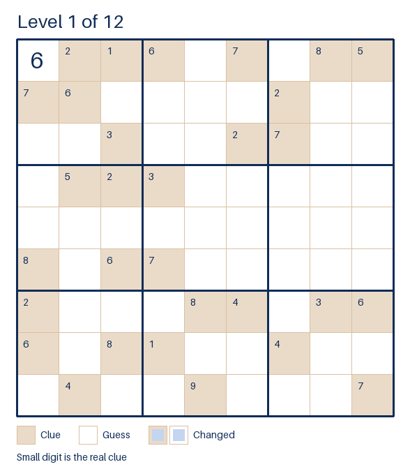

# ncm-sudoku-gifs

> **Unofficial.** This is a tiny addition for [HazyResearch/ncm](https://github.com/HazyResearch/ncm). It is not affiliated with or endorsed by the NCM authors.

NCM (Next-Concept Modeling) generates an output from coarse to fine. Each level adds detail and decoding every level allows one to see the sample being refined. Within the original repository there is a gif for text, I decided to build one for the sudoku problems. Pick one of the three difficulty levels and it generates a GIF for each puzzle.

The repository is an addition and does not modify your NCM clone. Fundamentally it runs NCM's own `scripts/eval_shard.py` as is. 

This code was largely generated by Anthropic's Claude Sonnet 5.5 model.

Here is an example of a generated GIF:
<p align="center"></p>

## Setup

Put this repository next to your NCM clone:

```
parent/
    ncm/                git clone https://github.com/HazyResearch/ncm.git
    ncm-sudoku-gifs/    this repository
```

1. Clone the NCM repository and follow their README for how to download the data and sudoku checkpoints. It uses HuggingFace.
2. Within the clone of this repository create an environment and install the requirements:

```
python -m venv .venv
source .venv/bin/activate
pip install -r requirements.txt
```

or with [uv](https://docs.astral.sh/uv/):

```
uv venv
source .venv/bin/activate
uv pip install -r requirements.txt --torch-backend=auto
```

(`--torch-backend=auto` picks the PyTorch build that matches your CUDA driver)

`requirements.txt` not only installs the requirements for this repository it also installs the requirements for the NCM repository. If your NCM clone is elsewhere edit the `-r` line within `requirements.txt`.

3. Like NCM, this also needs a CUDA GPU.

## Usage

From this repository:

```
uv run ncm-sudoku-gifs.py --difficulty hard --n 10 --out-dir gifs
```

This generates gifs for the first 10 puzzles. Before generating the output it shows which config, checkpoint folder, and data folder it is going to use.

### Options

| Flag | Meaning |
| --- | --- |
| `--difficulty` | `easy`, `medium` or `hard` (required) |
| `--n` | Use the first N test puzzles (default 10) |
| `--out-dir` | Where the GIFs go, relative to where you run it (default `gifs`) |
| `--only-solved` | Skip puzzles the model got wrong |
| `--level-seconds` | Time on each level (default 2.0) |
| `--final-seconds` | Time on the final level (default 5.0) |
| `--lock-clues` | Always draw the true clue digits |
| `--ncm-root` | Path to the NCM clone (default `../ncm`, or `$NCM_ROOT`) |
| `--checkpoint-dir`, `--data-dir` | Override the checkpoint and data folders |
| `--split`, `--bs`, `--seed` | Test split, batch size, random seed |
 
Any flag it doesn't recognise is passed on to NCM's `eval_shard.py`.

## Credit

Please go and read the original [paper](https://arxiv.org/abs/2610.14162), and if you use this cite their paper:

```
@misc{kumbong2026nextconcept,
      title={Next-Concept Modeling: Fast, Parallel Coarse-to-Fine Text Generation},
      author={Hermann Kumbong and Ishan S. Khare and Iddah Mlauzi and Andrew Woen and Charles Ding and E. Kelly Buchanan and Simran Arora and Azalia Mirhoseini and Christopher Ré},
      year={2026},
      eprint={2610.14162},
      archivePrefix={arXiv},
      primaryClass={cs.CL},
      url={https://arxiv.org/abs/2610.14162},
}
```
